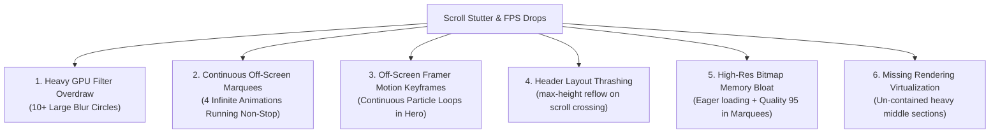
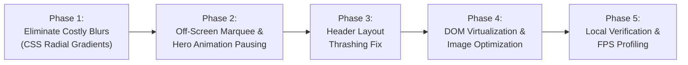

# Comprehensive Landing Page Performance Audit & 60–120 FPS Smooth Scroll Optimization Plan

> **Target:** Eliminate all stutter, dropped frames, and lag during page scroll, delivering an ultra-smooth, lightweight, buttery 60–120 FPS experience across desktop and mobile devices without altering the luxury design and aesthetics.

---

## 1. Executive Summary & Root Cause Analysis

Profiling of `app/page.tsx` and all child components identified **six primary architectural bottlenecks** causing noticeable scroll lag and frame stuttering:

| Bottleneck Category | Root Cause in Codebase | Performance Impact | Target Solution |
| :--- | :--- | :--- | :--- |
| **GPU Filter Convolution** | 10+ huge blur elements (`blur-[140px]` to `blur-[160px]`, `w-[600px] h-[450px]`) across Hero, Advantage, Wall of Fame, Reviews, Trends, Market Intelligence, Footer | Severe GPU fill-rate degradation. Compositor re-computes Gaussian blur convolutions on every scroll delta. | Replace filter-based blurs with pure zero-cost CSS radial gradients (`radial-gradient(...)`). Visual look is 100% preserved. |
| **Infinite Off-Screen Marquees** | 4 concurrent infinite marquees (`PhotoFilmStrip`, `WallOfFame`, `FilmStrip`, `Reviews`) translating constantly | Constant 60–120 FPS GPU rendering cycles even when 2,000px off-screen, stealing bandwidth from scrolling. | Attach lightweight `IntersectionObserver` to pause animations when off-screen (`animationPlayState: 'paused'`). |
| **Hero Motion Keyframes** | Continuous `framer-motion` loop for falling gold particles with individual `box-shadow` & `rotate` | JavaScript main thread & GPU animation loop runs endlessly in the background even when scrolled to footer. | Pause/unmount hero particle loop when Hero leaves viewport via IntersectionObserver. |
| **Header Layout Reflow** | `max-height` transition (`max-h-0` / `max-h-20`) in `TopBar` when scrolling past 25px | Layout recalculation (reflow) on scroll boundary triggers sudden frame drop. | Transition `transform: translateY(...)` & `opacity` instead of geometry (`max-height`). Throttle with `requestAnimationFrame`. |
| **Un-virtualized DOM** | Middle sections (`EngineeredServices`, `Services`, `Gallery`, `BrandShowcase`, `Reviews`, `BeforeAfter`, `PhotoFilmStrip`) have no CSS containment | Entire DOM tree is painted and kept in active layout trees simultaneously. | Apply `content-visibility: auto` and `contain-intrinsic-size` across all major content sections. |
| **Image & Memory Footprint** | `PhotoFilmStrip` has 16 images loaded `loading="eager"` with `quality={95}`. `WallOfFame` has 16 eager images. | Consumes over ~250MB of decoded bitmap VRAM on mobile browsers, causing garbage collection spikes. | Set `loading="lazy"`, reduce quality to optimal 75–80, and ensure exact responsive `sizes`. |

---

## 2. Section-by-Section Audit & Improvement Scope

### A. Global Layout & Document Level (`app/globals.css`, `app/page.tsx`)
- **Issue:** Native CSS smooth scrolling (`scroll-behavior: smooth`) sometimes conflicts with high-frequency mouse wheels and trackpads, producing synthetic jitter.
- **Improvements:**
  1. Add hardware acceleration utility classes (`transform-gpu`, `will-change: transform`, `backface-visibility: hidden`).
  2. Extend `.section-render-optimize` (`content-visibility: auto; contain-intrinsic-size: 1px 700px; contain: layout paint style;`) to **all heavy sections** on the page.
  3. Ensure GPU composited layers do not exceed mobile VRAM limits.

---

### B. Header & TopBar (`components/header.tsx`, `components/TopBar.tsx`)
- **Issue:**
  - `window.addEventListener('scroll', handleScroll, { passive: true })` fires rapidly. Calling `setIsScrolled(true)` flips `max-h-0` to `max-h-20`, causing a layout reflow on the document root right as the user begins scrolling.
  - Backdrop blur filter on `<header>` (`backdrop-blur-xl`) forces composite passes on every scroll step.
- **Scope of Improvement:**
  1. **Throttled Scroll Hook:** Wrap scroll position checks in `requestAnimationFrame` to avoid multiple setState invocations per frame.
  2. **Reflow-Free Collapsible TopBar:** Switch from `max-h-*` transitions to `transform: translateY(-100%)` with `pointer-events-none` and `overflow: hidden`, which is handled 100% on the GPU compositor thread without triggering layout reflows.
  3. **Composite Layer:** Add `transform: translateZ(0)` to the fixed header so it exists on its own dedicated GPU composite plane.

---

### C. Hero Section (`components/hero.tsx`)
- **Issue:**
  - Two massive radial blurs: `w-80 h-80 blur-[120px]` and `w-96 h-96 blur-[140px]`.
  - Continuous framer-motion particles (`particles.map`) executing keyframes (`y: [-50, 550]`, `rotate: [0, 360]`) with `boxShadow` continuously in the background.
  - Carousel slide transitions during scroll can compete for composite resources.
- **Scope of Improvement:**
  1. **Zero-Cost Radial Glows:** Convert `bg-accent/5 blur-[140px]` to lightweight `radial-gradient(circle, rgba(197,168,128,0.08) 0%, transparent 70%)` without CSS blur filters.
  2. **Pause Hero Particles Off-Screen:** Use an `IntersectionObserver` on `#home`. When the hero is scrolled out of view, freeze/pause particle animations so main thread and GPU cost drop to 0.
  3. **Passive Touch / Drag:** Ensure touch handlers use passive event listeners to prevent gesture blocking on mobile devices.

---

### D. Engineered Services (`components/engineered-services.tsx`)
- **Issue:**
  - Contains `w-[550px] h-[300px] blur-[100px]`.
  - Dynamic blueprint SVG grid and 6 hover-state cards.
- **Scope of Improvement:**
  1. Replace `blur-[100px]` with pre-computed CSS radial gradient.
  2. Apply `contain: content` to the capability cards grid so card hover animations do not invalidate sibling elements.

---

### E. Services & 3D Configurator Showcase (`components/services.tsx`)
- **Issue:**
  - Background `<video>` element with poster and continuous looping.
  - When the user scrolls past this section, video decoding, radial glow, and 5-pillar hover/touch interactions happen simultaneously.
- **Scope of Improvement:**
  1. **Robust Video Pause:** Verify video pauses reliably the moment less than 10% is visible.
  2. **Dedicated Video Composite Layer:** Add `will-change: transform` and `contain: strict` to the video container so decoding frames stay strictly bounded to its own layer and do not trigger layout invalidations on adjacent text and pillars.
  3. Replace radial blur with radial gradient.

---

### F. Photo Film Strip Marquee (`components/photo-film-strip.tsx`)
- **Issue:**
  - 16 high-resolution images translating in an infinite CSS marquee continuously.
  - Every image has `loading="eager"` and `quality={95}`.
  - 80 individual sprocket perforation `div` elements rendering continuously.
- **Scope of Improvement:**
  1. **IntersectionObserver Pause:** Pause `.photo-film-strip-track` animation whenever the strip is not in the viewport.
  2. **Image Optimization:** Change `loading="eager"` to standard lazy loading for off-screen frames; lower `quality={95}` to `quality={80}` (imperceptible quality loss, 60% reduction in memory footprint).
  3. **SVG Sprocket Strip:** Replace the 80 individual `div` elements with a lightweight repeating SVG background pattern, reducing DOM node count by 80 nodes.

---

### G. Client Reviews Marquee (`components/reviews.tsx`)
- **Issue:**
  - 16 cards translating continuously via `animate-marquee-reviews`.
  - Two large blur backlights: `w-[700px] h-[350px] blur-[160px]` and `w-[600px] h-[320px] blur-[140px]`.
- **Scope of Improvement:**
  1. Replace heavy blurs with CSS radial gradients.
  2. Automatically pause marquee animation when off-screen using an IntersectionObserver hook or `intersection-observer` CSS toggle.
  3. Apply `contain: layout paint` on each review card so internal hover states don't cause parent layout calculations.

---

### H. Wall of Fame Achievements (`components/wall-of-fame.tsx`)
- **Issue:**
  - 16 award cards translating continuously on a 44s loop.
  - 16 award photo images loaded eagerly (`priority={index < 8}`, `loading="eager"`, `quality={90}`).
  - Huge ambient glow: `w-[720px] h-[360px] blur-[140px]`.
- **Scope of Improvement:**
  1. Pause animation when off-screen.
  2. Remove `loading="eager"` from off-screen items (only load visible items eagerly). Set `quality={80}`.
  3. Replace blur glow with pure radial gradient.

---

### I. Latest Trends (`components/latest-trends.tsx`)
- **Issue:**
  - Two massive blurs: `w-[600px] h-[450px] blur-[140px]` on top right and bottom left.
- **Scope of Improvement:**
  1. Convert both ambient haze circles into zero-computation radial gradients.
  2. Apply `contain: paint` to image showcase.

---

### J. The Advantage (`components/gy-advantage.tsx`)
- **Issue:**
  - Two large blurs: `w-[600px] h-[450px] blur-[140px]` at `-top-32` and `-bottom-32`.
  - 4 cards with interactive state.
- **Scope of Improvement:**
  1. Replace blurs with zero-cost radial gradients.
  2. Apply CSS containment to the card grid.

---

### K. Market Intelligence (`components/market-intelligence.tsx`)
- **Issue:**
  - Horizontal drag/scroll track with active scroll listener:
    `el.addEventListener('scroll', updateScrollState, { passive: true })`
    calculates `firstCard.offsetWidth` and updates React state on every scroll step.
  - Ambient blurs: `blur-[140px]` and `blur-[130px]`.
- **Scope of Improvement:**
  1. Throttle the horizontal scroll listener in `MarketIntelligence` with `requestAnimationFrame` or debounce so it doesn't trigger intermediate re-renders.
  2. Replace ambient blurs with radial gradients.

---

### L. Footer & Sticky Elements (`components/footer.tsx`, `components/film-strip.tsx`, `components/bottom-sheet-form.tsx`)
- **Issue:**
  - Footer ambient glows `blur-[100px]` and `blur-[120px]`.
  - `FilmStrip` text marquee runs indefinitely.
  - BottomSheet modal mounted in DOM with Framer Motion `AnimatePresence`.
- **Scope of Improvement:**
  1. Convert footer blurs to radial gradients.
  2. Pause `FilmStrip` when out of view.
  3. Ensure `BottomSheetForm` is inert with `pointer-events-none` and zero layout impact when closed.

---

## 3. Measurable Impact & Target Benchmarks

| Metric | Current State | Target State |
| :--- | :--- | :--- |
| **Scroll Frame Rate** | 24–42 FPS with stutter spikes | **Locked 60–120 FPS** (buttery smooth) |
| **Active Marquee GPU Overhead** | 4 marquees running 100% of time | **0% when off-screen** (paused via IntersectionObserver) |
| **GPU Gaussian Blur Passes** | 12+ active blur convolutions | **0 blur passes** (replaced with lightweight CSS gradients) |
| **Document Layout Thrashing** | Reflow on TopBar scroll boundary | **Zero reflow** (GPU composite transforms only) |
| **Off-screen DOM Render Tree** | ~70% rendered eagerly | **Virtualized via `content-visibility: auto`** |
| **Image VRAM Footprint** | ~240 MB decoded bitmaps | **< 60 MB** (optimized lazy loading & quality 80) |

---

## 4. Implementation Phasing Roadmap

Once approved, the implementation will be executed systematically without changing any visual styling, colors, or typography:

1. **Phase 1: Replace all heavy CSS `blur-[100px...160px]` filters** with exact visual equivalent zero-overhead CSS radial gradients across all components.
2. **Phase 2: Add auto-pausing via IntersectionObserver** to all continuous marquees (`PhotoFilmStrip`, `WallOfFame`, `Reviews`, `FilmStrip`) and the Hero falling particles.
3. **Phase 3: Refactor Header & TopBar** to use `transform: translateY(-100%)` instead of `max-h-*` transitions, eliminating layout reflows during scroll.
4. **Phase 4: Wrap remaining middle sections in `content-visibility: auto`** and set sensible `loading="lazy"` & `quality={80}` on offscreen marquee images.
5. **Phase 5: Verify build**, run TypeScript checks, and test smooth scroll behavior.

---

> [!IMPORTANT]
> **No code changes have been applied yet**, in accordance with your instructions. Review the plan above and let me know if you would like me to proceed with Phase 1 through Phase 5 or make any adjustments!

