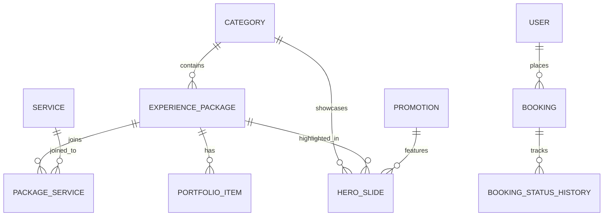

# 01. Site Architecture & Technical Stack Analysis

This document provides a technical deep-dive into the architectural foundations, libraries, database design, and external services powering the website.

---

## 1. High-Level Technology Stack

| Layer | Technology | Details / Version |
| :--- | :--- | :--- |
| **Framework** | [Next.js](https://nextjs.org/) | Next.js 16.2.6 (App Router with Server Components & Server Actions) |
| **Runtime & UI** | [React](https://react.dev/) | React 19 / React DOM 19 |
| **Styling** | [Tailwind CSS](https://tailwindcss.com/) | Tailwind CSS v4.2.0 with PostCSS, `@tailwindcss/postcss`, `tw-animate-css` |
| **Component Primitives** | [Base UI](https://base-ui.com/) & [Radix / shadcn](https://ui.shadcn.com/) | Modern accessible primitives, class-variance-authority, clsx, tailwind-merge |
| **Animation Engine** | [Framer Motion](https://www.framer.com/motion/) | Framer Motion v12 for scroll-linked animations, parallax effects, tab transitions |
| **Database & ORM** | [Prisma](https://www.prisma.io/) + [Neon](https://neon.tech/) | Prisma 7.8 with Neon Serverless PostgreSQL / `@prisma/adapter-pg` |
| **Authentication** | [Better-Auth](https://www.better-auth.com/) | Better-Auth 1.6 with credentials, session cookies, and role-based permissions |
| **Media Management** | [Cloudinary](https://cloudinary.com/) | Cloudinary SDK v2.10 for salon imagery, before/after media, and video delivery |
| **Email Service** | [Resend](https://resend.com/) | Resend v6 for customer confirmations and staff alert emails |
| **Automation** | [Zapier](https://zapier.com/) | Webhook triggers for CRM, Google Sheets, and WhatsApp dispatch |
| **Analytics & Telemetry** | Google Tag Manager + GA4 + Vercel Analytics | Custom `dataLayer` push events on phone clicks, bookings, and service selections |

---

## 2. Directory Structure Overview

```
greenAndYoung/
├── app/                              # Next.js App Router (Routes & Layouts)
│   ├── admin/                        # Secure Admin Management Portal
│   │   ├── appointments/             # Appointment management table
│   │   ├── bookings/                 # Booking list and status tracking
│   │   ├── catalog/                  # Service & Package editor
│   │   ├── marketing/                # Hero banner & promotion manager
│   │   ├── people/                   # Users and staff permissions
│   │   ├── studio/                   # Gallery & media asset manager
│   │   ├── layout.tsx                # Admin sidebar and auth guards
│   │   └── page.tsx                  # Metrics dashboard (KPIs, recent bookings)
│   ├── api/                          # Backend API Route Handlers
│   │   ├── auth/                     # Better-Auth authentication endpoints
│   │   ├── bookings/                 # Booking creation, status update, email trigger
│   │   ├── contact/                  # Contact form inquiries
│   │   ├── hero/                     # Hero slides CMS queries
│   │   ├── services/                 # Dynamic service catalog endpoints
│   │   └── upload/                   # Cloudinary asset upload handler
│   ├── auth/                         # Customer & Admin login/register pages
│   ├── globals.css                   # Tailwind v4 theme tokens and color definitions
│   ├── layout.tsx                    # Root HTML layout, SEO metadata, JSON-LD Schema
│   └── page.tsx                      # Main Landing Page (Server Component)
├── components/                       # UI Component Library
│   ├── admin/                        # Admin-specific modal dialogs & manager tables
│   ├── ui/                           # Base UI components (buttons, dialogs, inputs)
│   ├── TopBar.tsx                    # Top bar with contact info & operating status
│   ├── header.tsx                    # Main navigation bar with logo and CTA
│   ├── hero.tsx                      # Dynamic hero slider with luxury badge & category tabs
│   ├── services.tsx                  # Interactive tabbed service menu with pricing
│   ├── why-choose-us-premium.tsx     # Instagram Reel phone mockup & value propositions
│   ├── brand-showcase.tsx            # Partner luxury brands ticker
│   ├── reviews.tsx                   # Testimonial reviews carousel
│   ├── gallery.tsx                   # Filterable media showcase
│   ├── before-after.tsx              # Interactive drag comparison slider
│   ├── about.tsx                     # Brand story & salon credentials
│   ├── booking.tsx                   # Integrated booking section
│   ├── booking-modal.tsx             # Dynamic multi-step appointment modal
│   ├── contact.tsx                   # Contact details, map, and inquiry form
│   ├── floating-actions.tsx          # Floating WhatsApp and Book Now mobile actions
│   └── footer.tsx                    # Footer with links, copyright, and business info
├── lib/                              # Core Utility Modules
│   ├── auth.ts                       # Better-Auth server configuration
│   ├── auth-client.ts                # Better-Auth client hooks
│   ├── cloudinary.ts                 # Cloudinary image uploader wrapper
│   ├── emails.ts                     # Resend email HTML templates
│   ├── prisma.ts                     # Prisma client singleton instance
│   ├── schemas.ts                    # Zod validation schemas
│   ├── utils.ts                      # ClassNames combiner (`cn`)
│   └── zapier.ts                     # Webhook dispatcher for booking leads
├── prisma/                           # Database Schema & Migrations
│   ├── schema.prisma                 # PostgreSQL database model definitions
│   ├── seed.ts                       # Master database seeder
│   └── seed-gallery.ts               # Gallery media seeder
├── public/                           # Static assets
│   ├── images/                       # Salon images, backgrounds, icons
│   ├── robots.txt                    # Search crawler rules
│   └── sitemap.xml                   # SEO sitemap
└── docs/                             # Project documentation (You are here)
```

---

## 3. Database Schema Architecture

The PostgreSQL database defined in `prisma/schema.prisma` is organized into five functional clusters:



### Core Models:
1. **Category**: High-level salon departments (Hair Care, Skin Care, Nail Salon, Makeup & Bridal, Massage Spa) filtered by `GenderType` (`WOMEN`, `MEN`, `UNISEX`).
2. **ExperiencePackage**: Curated service packages (e.g., "Balayage Couture & Gloss", "Royal Charcoal Detan"). Contains duration, pricing, badge tags, and inclusions.
3. **Service**: Individual treatment offerings linked to packages via `PackageService`.
4. **HeroSlide**: Slides rendered on the top hero carousel, linked to a category, package, and promotional badge.
5. **Booking**: Customer appointment records storing customer contact, scheduled slot, booked service/package, status (`PENDING`, `CONFIRMED`, `COMPLETED`, `CANCELLED`), and payment state.
6. **BeforeAfterImage**: Interactive before-and-after image pairs demonstrating salon results.
7. **User & Session**: Auth tables managed by Better-Auth with roles (`SUPER_ADMIN`, `ADMIN`, `MANAGER`, `STAFF`, `CUSTOMER`).

---

## 4. Server-Side Data Flow

1. **Page Load (`app/page.tsx`)**:
   - The landing page is a **Next.js Server Component** (`force-dynamic`).
   - Directly queries Prisma for active `HeroSlide` entries (filtering `status: 'PUBLISHED'` and valid date ranges).
   - Lazily loads below-the-fold sections via `next/dynamic` (`WhyChooseUsPremium`, `Reviews`, `Gallery`, `BeforeAfter`, `Booking`, etc.) with pulse skeleton placeholders for optimal initial render speed and Core Web Vitals.

2. **Lead Generation & Booking Flow**:
   - Customer initiates booking from the Hero CTA, Service card, or Floating Action.
   - The multi-step `BookingModal` collects service selection, date, time slot, and customer details.
   - Pushes client analytics to `dataLayer` (`appointment_started`, `service_selected`).
   - Posts to `/api/bookings` -> Validates with Zod (`schemas.ts`).
   - Creates a transaction in PostgreSQL -> Triggers Zapier catch-hook -> Dispatches confirmation emails via Resend.
