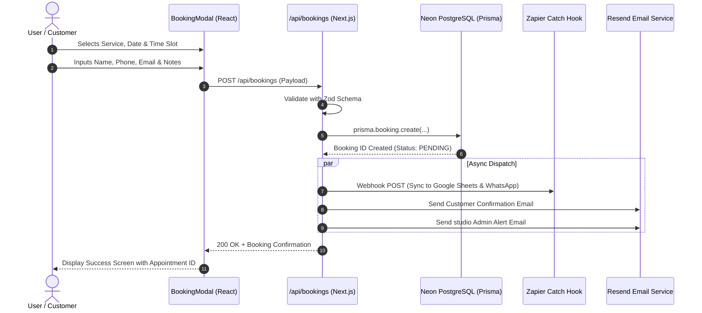

# 03. Component Breakdown & Data Flow

This document details every major UI component rendered on the main landing page, their data sources (database query vs. local props), and how data flows through the application.

---

## 1. Landing Page Hierarchy (`app/page.tsx`)

The main page is structured sequentially to maximize conversion, trust, and luxury presentation:

```mermaid
flowchart TD
    A[Root Layout: layout.tsx] --> B[TopBar: components/TopBar.tsx]
    A --> C[Header / Navigation: components/header.tsx]
    A --> D[Hero Section: components/hero.tsx]
    A --> E[Service Catalog: components/services.tsx]
    A --> F[Why Choose Us & Reel: components/why-choose-us-premium.tsx]
    A --> G[Partner Brands: components/brand-showcase.tsx]
    A --> H[Customer Reviews: components/reviews.tsx]
    A --> I[Curated Gallery: components/gallery.tsx]
    A --> J[Interactive Before/After: components/before-after.tsx]
    A --> K[Brand Story / About: components/about.tsx]
    A --> L[Integrated Booking Section: components/booking.tsx]
    A --> M[Contact, Map & Hours: components/contact.tsx]
    A --> N[Footer: components/footer.tsx]
    A --> O[Floating Mobile Actions: components/floating-actions.tsx]
```

---

## 2. Component Inventory & Data Source Matrix

| Component | File Path | Data Source | Dynamic Features |
| :--- | :--- | :--- | :--- |
| **TopBar** | `components/TopBar.tsx` | Static JSX | Live status badge, quick phone, email, and social links |
| **Header** | `components/header.tsx` | Static + Session Hook | Logo, navigation anchors, auth status, admin badge |
| **Hero** | `components/hero.tsx` | **Prisma Database** (`prisma.heroSlide`) | Dynamic slides, category pills, package links, video/image frames |
| **Services** | `components/services.tsx` | Database / Fallback Seed | Gender switcher (`Women`, `Men`), category tabs, pricing cards |
| **Why Choose Us** | `components/why-choose-us-premium.tsx` | Static + Cloudinary Video | Realistic Instagram smartphone reel with audio indicator |
| **Brand Showcase** | `components/brand-showcase.tsx` | Static Array | Luxury product partner ticker (L'Oréal, Kérastase, Dyson, etc.) |
| **Reviews** | `components/reviews.tsx` | Static / DB (`prisma.review`) | Star rating, verified customer testimonials, Google review link |
| **Gallery** | `components/gallery.tsx` | Static / Cloudinary | Category-filtered gallery grid (Hair, Bridal, Skin, Interior) |
| **Before / After** | `components/before-after.tsx` | Database (`prisma.beforeAfterImage`) | Draggable split comparison slider with touch and mouse support |
| **About** | `components/about.tsx` | Static + DB image | Brand story, experience statistics, key studio pillars |
| **Booking** | `components/booking.tsx` | Database / API | Embedded booking form with date, time, service selection |
| **Booking Modal** | `components/booking-modal.tsx` | Client State + API | Pop-up overlay triggered from any "Book Now" CTA |
| **Contact** | `components/contact.tsx` | Static + Interactive Map | Quick call, WhatsApp card, opening hours, Google Maps embed |
| **Footer** | `components/footer.tsx` | Static JSX | Site directory, phone, address, copyright, social links |
| **Floating Actions**| `components/floating-actions.tsx` | Client State | Floating WhatsApp button + quick appointment button on mobile |

---

## 3. Data Flow & Booking Lifecycle

---

## 4. Admin Management Modules (`app/admin`)

The `/admin` portal gives the studio manager and staff full control over the website's dynamic content without touching code:

1. **Appointments (`/admin/appointments`)**: Live table of all scheduled bookings, filtering by date, status, and service. Quick status transition buttons (`Confirm`, `Complete`, `Cancel`).
2. **Catalog (`/admin/catalog`)**: Create and edit categories, service items, pricing, package bundles, and durations.
3. **Marketing (`/admin/marketing`)**: Hero banner manager, promotional badges, discount announcements, and start/end scheduling dates.
4. **Studio (`/admin/studio`)**: Upload and manage gallery imagery and before/after transformation pairs directly to Cloudinary.
5. **People (`/admin/people`)**: Manage staff accounts and role permissions (`SUPER_ADMIN`, `ADMIN`, `MANAGER`, `STAFF`).
