# 05. Customization Roadmap: The Best Approach

This roadmap presents the **safest, most maintainable, and visually faithful strategy** to customize this site for **Green and Young** without altering its luxury look and feel.

---

## 1. Core Architectural Strategy: Centralized Configuration

### The Problem with the Current Setup
Currently, brand strings (`"Habibs"`, phone numbers, email addresses, Instagram handles, address coordinates) are hardcoded across 30+ separate JSX and TypeScript files. This makes changing details prone to missed strings, inconsistent data, and broken links.

### The Best Practice Solution
Create a single source of truth: `lib/site-config.ts`.
All UI components, SEO tags, email templates, and schema structures will import from this file. If the client changes their salon phone number or Instagram handle in the future, it is updated in one place with zero chance of breaking UI layout or styles.

```ts
// Example: lib/site-config.ts
export const siteConfig = {
  name: "Green and Young Salon",
  legalName: "Green and Young Hair & Beauty Salon",
  shortName: "Green & Young",
  tagline: "Luxury Hair, Beauty & Wellness Sanctuary",
  description: "Experience bespoke hair styling, luxury bridal beauty, and revitalizing skin treatments at Green and Young Salon.",
  url: "https://greenandyoung.com",
  phone: "+91 97317 32547", // Replace with official Green & Young contact
  whatsapp: "+919731732547",
  email: "info@greenandyoung.com",
  adminEmail: "admin@greenandyoung.com",
  address: {
    street: "Gaur City, Greater Noida West",
    city: "Greater Noida",
    state: "Uttar Pradesh",
    postalCode: "201301",
    country: "India",
  },
  social: {
    instagram: "https://instagram.com/greenandyoung.salon",
    facebook: "https://facebook.com/greenandyoung.salon",
    whatsappLink: "https://wa.me/919731732547?text=Hi%2C%20I%20would%20like%20to%20book%20an%20appointment%20at%20Green%20and%20Young%20Salon.",
  },
  openingHours: "Mon - Sun: 10:00 AM - 9:00 PM",
  logo: "/images/green-and-young-logo.webp",
  icon: "/images/green-and-young-icon.webp",
  heroVideo: "https://res.cloudinary.com/dniebxelj/video/upload/q_auto,f_auto,w_400/v1781549376/kling_20260616_VIDEO_Luxury_pre_673_0_mlxqrj.mp4"
}
```

---

## 2. Six-Phase Implementation Roadmap

```mermaid
gantt
    title Green & Young Customization Roadmap
    dateFormat  X
    axisFormat %s

    section Phase 1
    Config Architecture & Constants        :p1, 0, 1
    section Phase 2
    Logo & Brand Visual Assets             :p2, 1, 2
    section Phase 3
    Frontend Components & Navigation Copy  :p3, 2, 4
    section Phase 4
    SEO Metadata & Schema.org JSON-LD      :p4, 4, 5
    section Phase 5
    Database Seed & Catalog Transition     :p5, 5, 7
    section Phase 6
    Email, Webhook & Admin QA              :p6, 7, 8
```



---

### Phase 1: Configuration & Single Source of Truth
- **Action**: Create [`lib/site-config.ts`](file:///x:/projects/next.js/Client-Projects/greenAndYoung/lib/site-config.ts) exporting all salon metadata.
- **Benefit**: Ensures 100% brand consistency across client-side components, server components, and API routes.
- **Risk Level**: Zero (purely additive).

---

### Phase 2: Brand Assets & Media Identity
- **Action**:
  - Add the official **Green and Young** logo to `/public/images/green-and-young-logo.webp`.
  - Maintain the exact dimensions (`height: 40px`, `scale-140`) to preserve header alignment without causing layout shift.
  - Update favicon and apple-touch icons.
  - Generate or curate high-resolution luxury salon imagery preserving the rich gold/warm atmosphere.
- **Preservation Check**: Ensure logo background is transparent PNG/WebP so it seamlessly blends into the header backdrop blur (`bg-black/10 backdrop-blur-[2px]`).

---

### Phase 3: Core UI & Component Copy Migration
- **Components to Update**:
  1. [`components/TopBar.tsx`](file:///x:/projects/next.js/Client-Projects/greenAndYoung/components/TopBar.tsx): Replace residual stall fabrication copy with salon hours, active booking status, and salon contact.
  2. [`components/header.tsx`](file:///x:/projects/next.js/Client-Projects/greenAndYoung/components/header.tsx): Connect logo image and alt text to `siteConfig`.
  3. [`components/hero.tsx`](file:///x:/projects/next.js/Client-Projects/greenAndYoung/components/hero.tsx): Update "Welcome to Habibs" -> "Welcome to Green and Young".
  4. [`components/why-choose-us-premium.tsx`](file:///x:/projects/next.js/Client-Projects/greenAndYoung/components/why-choose-us-premium.tsx): Update headline and Instagram phone mockup username to `@greenandyoung.salon`.
  5. [`components/about.tsx`](file:///x:/projects/next.js/Client-Projects/greenAndYoung/components/about.tsx): Tailor the salon story to Green and Young's heritage, certified master stylists, and premium client experience.
  6. [`components/services.tsx`](file:///x:/projects/next.js/Client-Projects/greenAndYoung/components/services.tsx): Update "Habibs Premiere" banner tag to "Green & Young Signature".
  7. [`components/footer.tsx`](file:///x:/projects/next.js/Client-Projects/greenAndYoung/components/footer.tsx): Update brand name, description, copyright year, and contact numbers.
  8. [`components/floating-actions.tsx`](file:///x:/projects/next.js/Client-Projects/greenAndYoung/components/floating-actions.tsx): Update WhatsApp pre-filled greeting message.

---

### Phase 4: SEO, OpenGraph & Structured Data
- **Action**:
  - Update [`app/layout.tsx`](file:///x:/projects/next.js/Client-Projects/greenAndYoung/app/layout.tsx) metadata (title, description, OpenGraph title/siteName, Twitter cards).
  - Update the Schema.org `BeautySalon` JSON-LD object with Green and Young's coordinates, telephone, pricing range, and official URLs.
  - Update [`public/robots.txt`](file:///x:/projects/next.js/Client-Projects/greenAndYoung/public/robots.txt) and [`public/sitemap.xml`](file:///x:/projects/next.js/Client-Projects/greenAndYoung/public/sitemap.xml).
- **Result**: Instant Google Search indexing for "Green and Young Salon" with rich snippet support (ratings, hours, telephone).

---

### Phase 5: Database Seeding & Catalog Alignment
- **Action**:
  - Update [`prisma/seed.ts`](file:///x:/projects/next.js/Client-Projects/greenAndYoung/prisma/seed.ts) to seed services under Green and Young branding.
  - Retain the exact category structure (Women: Hair, Skin, Nail, Makeup; Men: Hair, Skin, Massage) and pricing tier schema so the frontend tabs and database relationships continue working without modification.
  - Execute `npx prisma db seed` to populate Neon PostgreSQL with pristine Green and Young packages and hero slides.

---

### Phase 6: Automated Workflows & Notifications
- **Action**:
  - Update [`lib/emails.ts`](file:///x:/projects/next.js/Client-Projects/greenAndYoung/lib/emails.ts) HTML templates to display "Green and Young Salon" branding in booking confirmations and feedback requests.
  - Verify Zapier webhook payload mapping (`lib/zapier.ts`).
  - Update `ADMIN_EMAIL` in `.env` for inquiry routing.

---

## 3. Pre-Launch Quality Assurance & Testing Checklist

- [ ] **Visual Layout Check**: Header, hero carousel, and footer render without overflow or misalignment.
- [ ] **No Residual Mentions**: Run global text search to ensure 0 instances of legacy brand text remain on user-facing pages.
- [ ] **Booking Flow Test**: Submit a real appointment through `BookingModal` and confirm database entry, Zapier webhook, and Resend email delivery.
- [ ] **Mobile Responsiveness**: Test touch interactions on iPhone / Android viewports (hamburger menu, WhatsApp floating pill, Before/After slider).
- [ ] **Performance & Lighthouse**: Verify mobile performance score remains > 90 with zero layout shift (CLS < 0.05).
- [ ] **Admin Portal Verification**: Log into `/admin` and confirm the hero slider manager, appointment table, and catalog editor function seamlessly.
