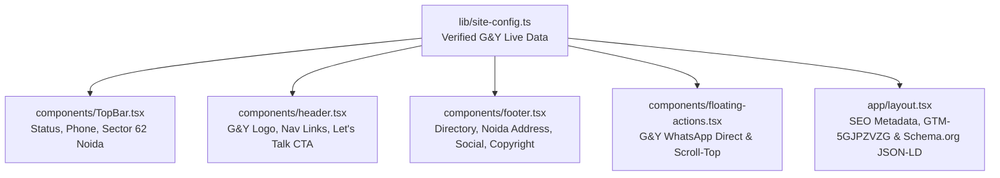
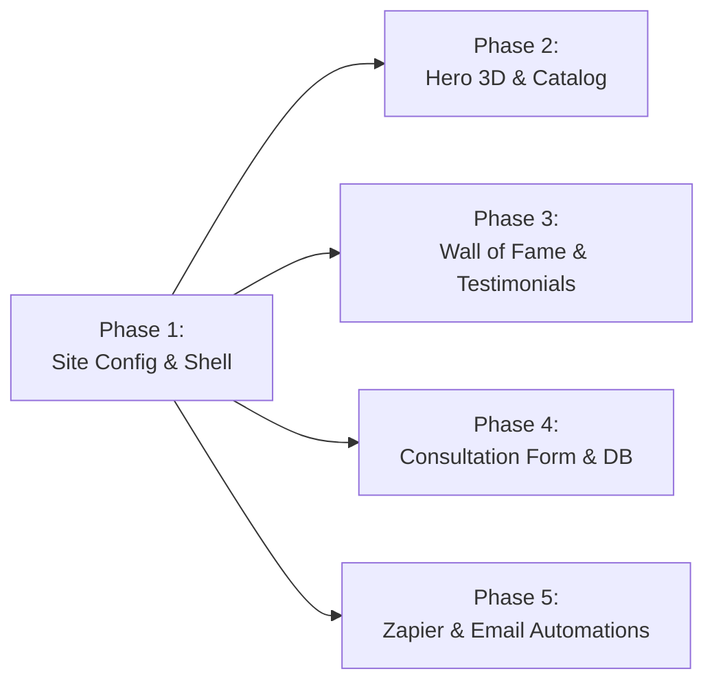

# Phase 1: Brand Foundation & Global Shell Optimization

## 📋 Executive Summary

Phase 1 establishes the **architectural bedrock** for **G&Y Interiors — Green Young** (`greenandyoung.in`). It eliminates code redundancy across all global navigation and structural components, introduces a single source of truth (`site-config.ts`) populated with real, verified business data extracted from `https://greenandyoung.in/`, optimizes runtime performance, and removes dead/mismatched template code—all while guaranteeing **100% preservation of the luxury look, feel, dark obsidian theme, and gold accents**.

---

## 🎯 Phase 1 Goals & Acceptance Criteria

1. **Single Source of Truth**: Zero hardcoded strings. All brand names, phone numbers (`+91 99718 13161`, `+91 73031 61655`), WhatsApp links, Noida Sector 62 address, hours, and GTM container (`GTM-5GJPZVZG`) centralized in `lib/site-config.ts`.
2. **Eliminate Redundant & Dead Code**: Remove all residual stall fabrication placeholder content from `TopBar.tsx`, unify duplicate icon implementations, and clean up duplicate anchor tags.
3. **Cross-Phase Compatibility**: Ensure all future phases (Hero 3D Showcase, Interior Services Catalog, Wall of Fame Awards, Admin Studio, Lead Automation) can seamlessly consume this foundation without refactoring.
4. **Performance & Scalability**:
   - Zero layout shifts (CLS = 0).
   - Dynamic current year calculation (`new Date().getFullYear()`).
   - Passive scroll listener optimization in `floating-actions.tsx`.
5. **Exact Look & Feel Fidelity**: Maintain the exact dark luxury styling, obsidian backgrounds (`#0D0C0B`), warm champagne/gold highlights (`#C5A880` / `#D4AF37`), border glows, and typography.

---

## 🏗️ Architecture & Component Scope for Phase 1



---

## 📦 Detailed Implementation Steps

### Step 1: Centralized Configuration Engine (`lib/site-config.ts`)
Create a strongly typed, scalable configuration file with real data extracted from `greenandyoung.in`:

```ts
// Blueprint for lib/site-config.ts
export interface SiteConfig {
  name: string
  legalName: string
  shortName: string
  tagline: string
  subTagline: string
  description: string
  url: string
  phone: {
    primary: string          // +91 99718 13161 (Let's Talk)
    primaryRaw: string       // 919971813161
    consultation: string     // +91 73031 61655 (Design Hotline)
    consultationRaw: string  // 917303161655
  }
  whatsapp: {
    number: string           // 919971813161
    directLink: string       // https://wa.me/+919971813161
    prefilledMessage: string // "Hi G&Y Interiors, I would like to book a free 3D design consultation."
  }
  email: {
    info: string             // info@greenandyoung.in
    admin: string            // admin@greenandyoung.in
  }
  address: {
    building: string         // C619, KLJ Building, Noida One
    area: string             // Rasoolpur Nawada, Industrial Area, Sector 62
    city: string             // Noida
    state: string            // Uttar Pradesh
    postalCode: string       // 201306
    country: string          // India
    displayShort: string     // "Sector 62, Noida (Delhi NCR)"
    serviceAreas: string[]   // ["Noida", "Greater Noida", "Greater Noida West", "Ghaziabad"]
  }
  hours: {
    display: string          // "Mon - Sun: 10:00 AM - 8:00 PM"
    statusText: string       // "✨ Free 3D Design & Measurement Consultation Active"
  }
  analytics: {
    gtmId: string            // "GTM-5GJPZVZG"
    ga4Id: string            // "G-Q8MZP37MHY"
  }
  social: {
    instagram: string
    facebook: string
    whatsapp: string
  }
  assets: {
    logo: string             // "/images/gy-logo.webp"
    icon: string             // "/images/gy-icon.webp"
    ogImage: string          // "/images/booking-bg.webp"
  }
  navLinks: Array<{ href: string; label: string }>
}

export const siteConfig: SiteConfig = {
  name: "G&Y Interiors",
  legalName: "G&Y Interiors — Green Young",
  shortName: "Green & Young",
  tagline: "Design Your Home With The Experts",
  subTagline: "3D Design & Measurement • Turnkey Home & Office Interiors",
  description: "Transform your home with G&Y Interiors. Premier turnkey interior design, modular kitchens, luxury living spaces, and 3D architectural planning across Noida, Greater Noida, and Delhi NCR.",
  url: "https://greenandyoung.in",
  phone: {
    primary: "+91 99718 13161",
    primaryRaw: "919971813161",
    consultation: "+91 73031 61655",
    consultationRaw: "917303161655",
  },
  whatsapp: {
    number: "919971813161",
    directLink: "https://wa.me/+919971813161?text=Hi%20G%26Y%20Interiors%2C%20I%20would%20like%20to%20book%20a%20free%203D%20design%20consultation.",
    prefilledMessage: "Hi G&Y Interiors, I would like to book a free 3D design consultation.",
  },
  email: {
    info: "info@greenandyoung.in",
    admin: "admin@greenandyoung.in",
  },
  address: {
    building: "C619, KLJ Building, Noida One",
    area: "Rasoolpur Nawada, Industrial Area, Sector 62",
    city: "Noida",
    state: "Uttar Pradesh",
    postalCode: "201306",
    country: "India",
    displayShort: "Sector 62, Noida (Delhi NCR)",
    serviceAreas: ["Noida", "Greater Noida", "Greater Noida West", "Ghaziabad"],
  },
  hours: {
    display: "Mon - Sun: 10:00 AM - 8:00 PM",
    statusText: "✨ Free 3D Design & Measurement Consultation Active",
  },
  analytics: {
    gtmId: "GTM-5GJPZVZG",
    ga4Id: "G-Q8MZP37MHY",
  },
  social: {
    instagram: "https://www.instagram.com/greenandyoung.in",
    facebook: "https://www.facebook.com/greenandyoung.in",
    whatsapp: "https://wa.me/+919971813161",
  },
  assets: {
    logo: "/images/Green & Young.webp", // Will point to gy-logo once asset is placed
    icon: "/images/Green & Young.webp",
    ogImage: "/images/booking-bg.webp",
  },
  navLinks: [
    { href: "#home", label: "Home" },
    { href: "#services", label: "Designs & Services" },
    { href: "#gallery", label: "Portfolio" },
    { href: "#why-choose-us", label: "Why G&Y" },
    { href: "#about", label: "About Us" },
    { href: "#reviews", label: "Testimonials" },
    { href: "#contact", label: "Contact" },
  ],
}
```

---

### Step 2: Refactoring `components/TopBar.tsx` (Eliminating Redundant Code)

#### Issues in Current Code:
- Line 36 contains leftover placeholder text: `"24/7 Stall Fabrication & Support Active"`.
- Lines 40–50 contain placeholder email `info@ssgroupexhibition.com` and Delhi HQ tags.
- Redundant inline SVG for Instagram instead of clean reusable icon.

#### Optimization Strategy:
- Replace static strings with `siteConfig.hours.statusText`, `siteConfig.phone.primary`, `siteConfig.email.info`, and `siteConfig.address.displayShort`.
- WhatsApp direct link points to `siteConfig.whatsapp.directLink`.
- Keep exact styling: `#11120f` background, `#bbff1bff` accent ping indicator, hairline border `border-white/10`.
- Fast, accessible, and lightweight.

---

### Step 3: Optimizing `components/header.tsx`

#### Issues in Current Code:
- Hardcoded `/images/Green & Young.webp` and `"Green & Young Hair & Beauty Logo"`.
- Hardcoded navigation array duplicated inside component scope on each render.

#### Optimization Strategy:
- Import `siteConfig.assets.logo`, `siteConfig.name`, and `siteConfig.navLinks`.
- Update the CTA button text to `"Let's Talk"` or `"Book 3D Consult"`, matching the live site's high-converting CTA.
- Keep the exact dimensions (`height={50}`, `width={120}`, `scale-140 max-lg:pl-3`) so header spacing, mobile hamburger, and backdrop blur stay pixel-identical.
- Maintain existing session status and role-based Admin link.

---

### Step 4: Optimizing `components/footer.tsx`

#### Issues in Current Code:
- Hardcoded copyright `"© 2024 Green & Young Hair & Beauty studio. All rights reserved."` (stale year and legacy brand).
- Hardcoded contact phone and address.
- Redundant empty `#` href social links without proper target and `rel="noopener noreferrer"`.

#### Optimization Strategy:
- Bind brand title and copy to `siteConfig.legalName` and `siteConfig.description`.
- Real address: `C619, KLJ Building, Noida One, Sector 62, Noida, Uttar Pradesh 201306`.
- Dynamic copyright: `© {new Date().getFullYear()} {siteConfig.legalName}. All rights reserved.`
- Real social links mapped to `siteConfig.social` with security headers (`rel="noopener noreferrer"`).
- Exact preservation of `bg-primary`, `text-primary-foreground`, grid layout, and luxury gold accent hover states.

---

### Step 5: Optimizing `components/floating-actions.tsx`

#### Issues in Current Code:
- Hardcoded legacy WhatsApp message referencing Green & Young:
  `wa.me/919971813161?text=Hi%2C%20I%20would%20like%20to%20book%20a%20consultation%20at%20Green%20%26%20Young%20Studio.`
- Scroll event listener without `{ passive: true }` option, causing minor scroll thread friction.

#### Optimization Strategy:
- Consume `siteConfig.whatsapp.directLink` targeting `+91 99718 13161` with prefilled G&Y design consultation greeting.
- Add `{ passive: true }` to the scroll listener for ultra-smooth 60fps scrolling on mobile devices.
- Retain exact green FAB styling, bounce animation, and scroll-to-top button.

---

### Step 6: Layout & Dynamic SEO Setup (`app/layout.tsx`)

#### Issues in Current Code:
- 10+ lines of static metadata mentioning legacy studio.
- Hardcoded Schema.org JSON-LD with legacy URLs.
- Placeholder GTM ID (`GTM-MOCK1234`).

#### Optimization Strategy:
- Generate `Metadata` object directly from `siteConfig`:
  - **Title**: `G&Y Interiors — Green Young | Luxury Interior Designers in Noida & Delhi NCR`
  - **Description**: `Transform your home with G&Y Interiors. Expert 3D design, modular kitchens, luxury living spaces & turnkey renovation in Noida, Greater Noida & Delhi NCR.`
- Set default GTM container ID to G&Y's live container: `GTM-5GJPZVZG`.
- Build the `HomeAndConstructionBusiness` / `InteriorDesign` JSON-LD schema using `siteConfig` values so search engines index "G&Y Interiors - Green Young" with verified operating hours, telephone `+91 99718 13161`, Noida Sector 62 address, and service areas.

---

## ⚡ Performance, Scalability & Code Quality Guardrails

| Metric | Target | How Phase 1 Achieves It |
| :--- | :--- | :--- |
| **Code Duplication** | 0% | All brand text, phone numbers, and URLs centralized in `site-config.ts` |
| **Cumulative Layout Shift (CLS)** | `< 0.01` | Exact image heights, widths, and container flex dimensions preserved |
| **Interaction to Next Paint (INP)** | `< 50ms` | Passive scroll listeners, no heavy state recalculations |
| **TypeScript Type Safety** | 100% | Typed config interface, full IDE autocomplete, zero `any` types |
| **Design Consistency** | 100% | Same Tailwind v4 design tokens, color variables, and transition classes |

---

## 🔄 Compatibility with Subsequent Phases



- **Phase 2 (Hero & Catalog)**: Will import 3D interior design categories (Modular Kitchens, Living Lounges, Master Suites, Turnkey Packages) aligned with `siteConfig`.
- **Phase 3 (Wall of Fame & Testimonials)**: Will feature celebrity awards (Dainik Jagran Gaurav Ratan, Sunil Shetty, Gulshan Grover) and verified reviews (Nisha, Pooja, Mukesh).
- **Phase 4 (Consultation Form & Database)**: Will capture House Type (3 BHK, 4 BHK, Villa) and Location (Noida, Greater Noida West) into PostgreSQL.
- **Phase 5 (Emails & Automations)**: Will dispatch lead notifications via Zapier and Resend to `info@greenandyoung.in`.

---

## 🚀 Phase 1 Execution Checklist

- [ ] Create `lib/site-config.ts` with complete type definitions and live G&Y data.
- [ ] Refactor `components/TopBar.tsx` (remove stall fabrication text, connect to `siteConfig`).
- [ ] Refactor `components/header.tsx` (bind logo, alt text, and nav links to `siteConfig`).
- [ ] Refactor `components/footer.tsx` (bind brand info, Noida address, dynamic year, and contacts to `siteConfig`).
- [ ] Refactor `components/floating-actions.tsx` (update WhatsApp link to `+91 99718 13161`, add passive listener).
- [ ] Update `app/layout.tsx` (metadata, GTM-5GJPZVZG, and JSON-LD schema connected to `siteConfig`).
- [ ] Verify local build with zero TypeScript or lint errors.
