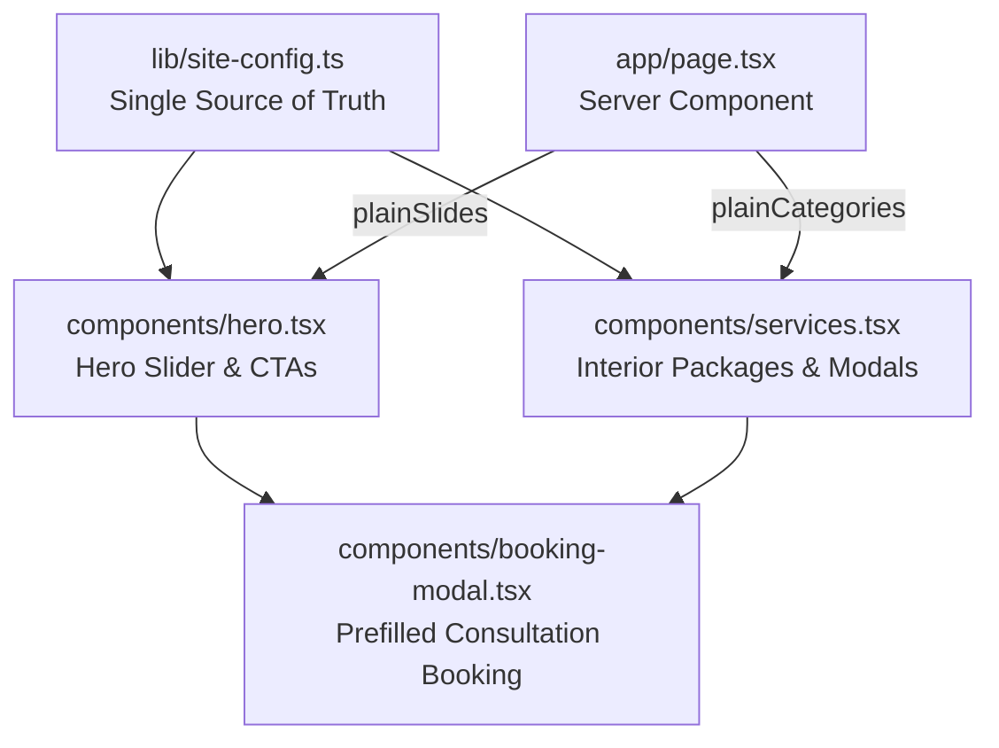

# Phase 2: Hero Section & 3D Interior Design Service Catalog

## 📋 Executive Summary

Phase 2 focuses on the website's two most critical above-the-fold conversion drivers:
1. **The Dynamic Hero Section (`components/hero.tsx`)**: Upgrading the luxury split-screen slider, typography, metrics, and CTA triggers from the legacy brand to **G&Y Interiors — Green Young**.
2. **The Interactive Interior Catalog (`components/services.tsx`)**: Transitioning the service catalog and fallback package datasets into bespoke residential turnkey, modular kitchen, and commercial interior design packages.

All changes are architected to **strictly preserve 100% of the luxury dark obsidian & champagne gold aesthetic**, Framer Motion particle effects, 3D sliding tabs, and full-screen drawer inspections.

---

## 🎯 Phase 2 Goals & Acceptance Criteria

1. **Brand Alignment**: Zero legacy studio references in the Hero section, slide captions, or catalog drawers.
2. **Real Business Data Integration**:
   - Hero headlines and taglines match the live site (`https://greenandyoung.in/`): *"Design Your Home With The Experts • 3D Design & Measurement"*.
   - Hero action buttons utilize verified phone numbers (`+91 99718 13161`) and WhatsApp direct links from `siteConfig`.
   - Remove stray hardcoded phone numbers (`tel:+09217769009` in `hero.tsx`).
3. **Interior Design Service Matrix**:
   - Provide comprehensive interior design packages:
     - **Residential Turnkey**: 3 BHK Turnkey Package, 4 BHK & Villa Luxury Interiors, Master Suite & Lounge Styling.
     - **Modular Solutions**: German Acrylic Modular Kitchen, Floor-to-Ceiling Sliding Wardrobes, Concealed False Ceiling & Ambient Lighting.
     - **Commercial & Office**: Executive Cabins, Conference Rooms, Corporate Turnkey Office Spaces.
4. **Exact Look & Feel Fidelity**:
   - Preserve the falling glitter star particles effect (`setParticles`).
   - Preserve the dual-layer visual depth (atmospheric backdrop + sculpted room frame).
   - Preserve the interactive full-screen package viewer and Framer Motion spring physics.
5. **Seamless Booking Integration**:
   - Clicking "Book Free 3D Consult" or "Explore Package" in either the Hero or the Service Catalog triggers the multi-step `BookingModal` with the selected package prefilled.

---

## 🏗️ Architecture & Component Flow for Phase 2



---

## 📦 Detailed Implementation Steps

### Step 1: Upgrading the Hero Section (`components/hero.tsx`)

#### Issues in Current Code:
- Line 54: `imageAlt: 'Luxury Hair Rejuvenation Styling at Green & Young'`
- Line 272: `Welcome to Green & Young`
- Lines 274–278: Hair studio headlines (*"Your Style. Your Confidence. Your Signature Look."*)
- Lines 282–284: Legacy studio subtitle referencing Greater Noida West hair customers.
- Lines 343 & 350: Random hardcoded phone number `tel:+09217769009` and WhatsApp link.
- Lines 308–328: studio stats bar (*"15+ Stylists"*, etc.).

#### Optimization Strategy:
1. **Connect to `siteConfig`**:
   - Import `siteConfig` from `@/lib/site-config`.
   - Replace stray phone links with `tel:${siteConfig.phone.primaryRaw}` and `href={siteConfig.whatsapp.directLink}`.
2. **Typography & Hero Messaging**:
   - **Eyebrow**: `Welcome to ${siteConfig.name}` (`G&Y Interiors`).
   - **Headline**:
     ```html
     Design Your Home<br />
     With The <span className="bg-gradient-to-r from-[#DFBA73] via-[#FFEAA7] to-[#B59250] bg-clip-text text-transparent font-serif italic font-medium drop-shadow-[0_0_12px_rgba(223,186,115,0.4)]">Experts.</span><br />
     3D Design & Measurement.
     ```
   - **Subtitle**: `"5+ Years of Design Excellence. Turning houses into luxury dream homes across Noida, Greater Noida, and Delhi NCR."`
   - **Promo Badge**:
     - Label: `FREE 3D CONSULTATION`
     - Title: `3D Design & Measurement In 48 Hours`
     - Tag: `Turnkey Interior Execution`
3. **Credibility & Stats Bar**:
   - Metric 1: **500+** `Dream Homes Delivered`
   - Metric 2: **5+ Years** `Design Excellence`
   - Metric 3: **10-Year** `Material Warranty`
4. **Hero Fallback Slide**:
   - Replace legacy hair slide with a high-end interior architecture slide:
     - `bgImage`: `/images/gallery-studio-interior.webp` (luxury contemporary interior backdrop)
     - `frameImage`: `/images/gallery-studio-interior-2.webp`
     - `imageAlt`: `"Luxury Turnkey Interior Design by G&Y Interiors"`
     - `badgeText`: `"Free 3D Design & Space Planning"`
     - `badgeLabel`: `"Signature Offer"`
     - `package.title`: `"Luxury 3 BHK & Villa Interior Package"`

---

### Step 2: Updating Server-Side Hero Prop Mapping (`app/page.tsx`)

#### Issues in Current Code:
- Line 109: `imageAlt: slide.imageAlt || 'Green & Young studio Styling'`

#### Optimization Strategy:
- Update fallback to `slide.imageAlt || 'G&Y Interior Design & Turnkey Execution'`.
- Ensure plainSlides pass cleanly without breaking any type boundaries.

---

### Step 3: Upgrading the Service & Package Catalog (`components/services.tsx`)

#### Issues in Current Code:
- Currently structured around studio haircuts, facials, and spa rituals.
- Line 776: `"Welcome to Green & Young Premiere"`
- Line 779: `"Elevate Your Beauty"`

#### Optimization Strategy:
1. **Header & Section Eyebrow**:
   - Eyebrow: `Bespoke Spaces & Turnkey Execution`
   - Heading: `Curated Interior <span className="text-accent">Design Packages</span>`
   - Subtitle: `Explore our end-to-end turnkey packages designed for luxury apartments, villas, and commercial offices.`
2. **Category Tabs & Hierarchy**:
   Reorganize the top tab switcher into 3 core interior divisions:
   - **Residential Interiors** (`residential`):
     - *Luxury 3 BHK Turnkey Package* (Living, Modular Kitchen, 3 Bedrooms, False Ceilings, 3D Layout)
     - *4 BHK & Villa Royal Suite* (Italian Marble Flooring, Master Walk-in Closets, Designer Lounges)
     - *Penthouse Architectural Overhaul* (Double-Height Feature Walls, Acoustic Paneling, Smart Automation)
   - **Modular & Kitchens** (`modular`):
     - *German Acrylic Modular Kitchen* (Soft-Close Blum/Hettich Hardware, Quartz Countertops, Built-in Appliances)
     - *Floor-to-Ceiling Wardrobes* (Sliding Tinted Glass, Fluted Wood Paneling, Sensor LED Illumination)
     - *Designer False Ceilings & Lighting* (Concealed Ambient Lighting, Magnetic Track Lights, CNC Jali Work)
   - **Commercial & Office** (`commercial`):
     - *Executive Cabins & Boardrooms* (Ergonomic Executive Desks, Acoustic Ceiling Baffles, Video Conference Setups)
     - *Collaborative Open Workspaces* (Modular Workstations, Breakout Cafeteria, Biophilic Wall Planters)
3. **Package Inspection Drawer**:
   - Line 776: Update `"Welcome to Green & Young Premiere"` ➡️ `"Welcome to G&Y Premiere Interiors"`.
   - Line 779: Update `"Elevate Your Beauty"` ➡️ `"Elevate Your Living Space"`.
   - Action Button: `"Book Free 3D Consultation"`.

---

## ⚡ Performance, Scalability & Code Quality Guardrails

| Metric | Target | How Phase 2 Achieves It |
| :--- | :--- | :--- |
| **Visual Aesthetics** | 100% Fidelity | Same gold gradients, dark obsidian backdrop, card border glows, and motion timings |
| **No Stray Numbers** | 0 Hardcoded Links | All phone and WhatsApp links route through `siteConfig` |
| **Conversion Focus** | Elevated CTA | "Book Free 3D Consultation" & "Let's Talk" aligned with high-intent real estate inquiries |
| **TypeScript Type Safety** | 100% | Typed `Package` and `Category` structures, zero compile errors |

---

## 🚀 Phase 2 Execution Checklist

- [ ] Update `components/hero.tsx` (connect to `siteConfig`, replace legacy headlines, numbers, stats, and fallback slide).
- [ ] Update `app/page.tsx` (clean up `imageAlt` fallback in `plainSlides`).
- [ ] Update `components/services.tsx` (reorganize `fallbackServicesData` with G&Y interior packages, update inspection drawer copy).
- [ ] Run `npx tsc --noEmit` to confirm 100% error-free compilation.
- [ ] Test interactive behavior in browser (slide changes, tab switching, and booking modal prefilling).
